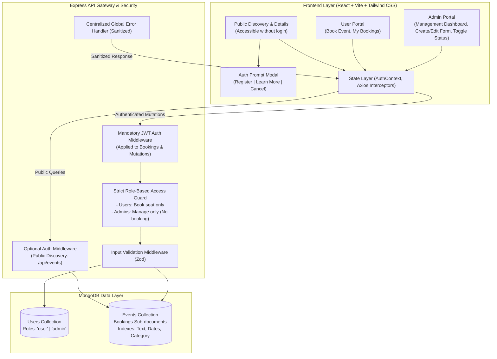
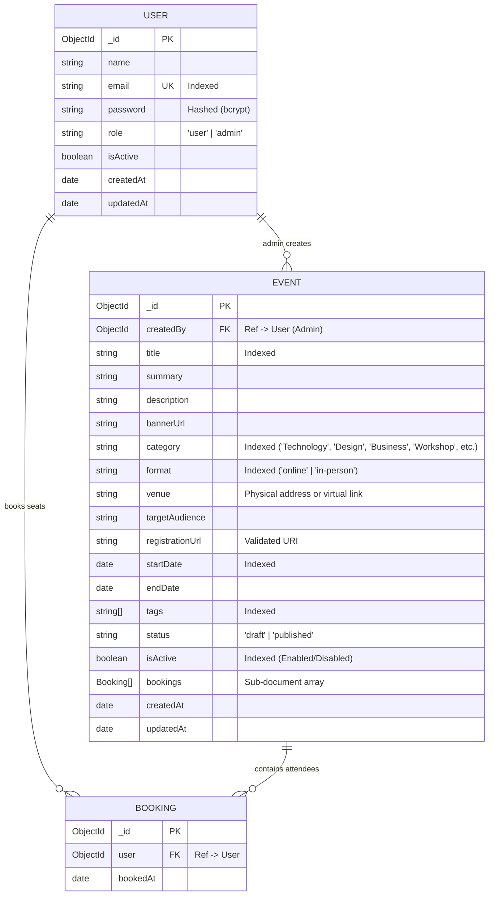

# Architecture & Technical Design Document
## Event Promotion & Discovery Platform (MERN Stack)

---

## 1. System Architecture Overview

The platform features a **Public Discovery & Role-Guarded Mutation Architecture**:
1. **Public Guest Visitors:** Can freely discover events, search, filter, and view event details without logging in. If they click **"Book Event"**, an interactive authentication prompt modal pops up offering **Register**, **Learn More** (dismiss), and **Cancel** actions.
2. **`user` (Authenticated Attendee):** Can discover events, view event details, reserve seats (`POST /api/events/:id/book`), and view registered events under **My Bookings** (`/my-bookings`). Cannot create, edit, delete, or toggle status of events.
3. **`admin` (Administrator):** Has full event lifecycle management (Create, Edit, Delete, Enable/Disable). **Admins are strictly prohibited from booking events.**

---

## 2. Database Schema & Data Modeling

### 2.1 Entity Relationship Diagram (ERD)

---

## 3. Security, Authentication & Role-Based Access Control (RBAC)

### 3.1 Authorization Matrix (RBAC)

| Action | Public Guest (Not Logged In) | User (`role='user'`) | Administrator (`role='admin'`) |
| :--- | :---: | :---: | :---: |
| Browse Discovery Catalog |  **Yes (Freely Accessible)** |  Yes |  Yes |
| Search & Filter Events |  **Yes (Freely Accessible)** |  Yes |  Yes |
| View Event Details |  **Yes (Freely Accessible)** |  Yes |  Yes |
| Click "Book Event" |  **Triggers Auth Prompt Modal** |  **Books Seat** |  **Blocked (403 Forbidden)** |
| View My Bookings |  Redirects to Login |  Yes (`/my-bookings`) |  No |
| **Create New Event** |  Redirects to Login |  **Blocked (403 Forbidden)** |  **Yes** |
| **Edit Event Details** |  Redirects to Login |  **Blocked (403 Forbidden)** |  **Yes** |
| **Delete Event** |  Redirects to Login |  **Blocked (403 Forbidden)** |  **Yes** |
| **Enable / Disable Event** |  Redirects to Login |  **Blocked (403 Forbidden)** |  **Yes** |

---

## 4. RESTful API Contract

### 4.1 Authentication Endpoints

| Method | Endpoint | Access | Description |
| :--- | :--- | :--- | :--- |
| `POST` | `/api/auth/register` | Public | Registers a new user. Role is strictly forced to `'user'`. |
| `POST` | `/api/auth/login` | Public | User portal login. Rejects admin accounts with 403. |
| `POST` | `/api/auth/login/admin` | Public | Dedicated Admin portal login. Rejects user accounts with 403. |
| `GET` | `/api/auth/me` | Authenticated | Retrieves current authenticated profile. |

### 4.2 Public Discovery Endpoints (No Login Required)

| Method | Endpoint | Access | Description |
| :--- | :--- | :--- | :--- |
| `GET` | `/api/events` | Public | Search and filter published events. Annotates `isBookedByCurrentUser` if token present. |
| `GET` | `/api/events/:id` | Public | View single event details. |

### 4.3 Protected Endpoints (Require Valid Bearer Token)

| Method | Endpoint | Permitted Role | Description |
| :--- | :--- | :--- | :--- |
| `POST` | `/api/events/:id/book` | **`user` only** | **Book seat for event. Strictly rejects admins (403).** |
| `GET` | `/api/events/user/my-bookings` | **`user` only** | List all events booked by the authenticated user. |
| `GET` | `/api/events/admin/all` | **`admin` only** | Administrator overview of all events with booking metrics. |
| `POST` | `/api/events` | **`admin` only** | Create and publish a new event. |
| `PUT` | `/api/events/:id` | **`admin` only** | Edit existing event details. |
| `DELETE`| `/api/events/:id` | **`admin` only** | Delete an event permanently. |
| `PATCH` | `/api/events/:id/status` | **`admin` only** | Toggle event between Enabled (`isActive: true`) and Disabled (`isActive: false`). |
